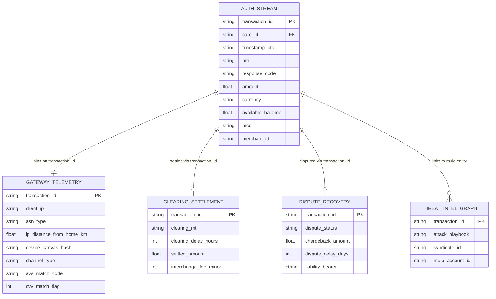

# FraudxAI: US 500,000 Transaction Benchmark Dataset (Seed 42)

## 1. Dataset Overview

The **FraudxAI US 500k Dataset** is a large-scale, enterprise-calibrated synthetic payment transaction benchmark comprising 500,000 credit, debit, and prepaid card transactions generated under deterministic random seed `42`.

The dataset is engineered to address the critical lack of realistic, multi-view operational transaction data in fraud detection research. Unlike legacy toy datasets that offer only unkeyed, PCA-anonymized tabular features, FraudxAI models the complete payment processing lifecycle across decoupled real-time authorization, asynchronous clearing, chargeback dispute recovery, and merchant network topology.

### Key Characteristics
* **Total Transactions:** 500,000
* **Cardholder Population:** 1,000 cards across 7 distinct human behavioral cohorts
* **Merchant Population:** 500 merchants across 25 MCC categories
* **Temporal Horizon:** Multi-month continuous stream with diurnal circadian rhythm and Hawkes self-exciting inter-arrival burstiness
* **Currency:** USD (cents / major units)
* **Target Label Leakage:** 0.00% across the real-time authorization feed (formally certified against `spec/07_export_leakage_gate.yaml`)
* **Ledger Invariant:** 100% double-entry conservation ($|\text{discrepancy}| < 10^{-6}$ USD)

---

## 2. Regulatory & Empirical Grounding

All generative priors, cardholder behaviors, and fraud vectors are calibrated to statutory requirements and central bank empirical data:
* **Federal Reserve DCPC / FRPS Surveys:** Calibrated merchant category frequency weights, transaction spend distributions, and debit vs. credit volume splits.
* **CFPB Regulation E (12 CFR § 1005.6 / § 1005.18):** Statutory consumer liability tiering (\$50 / \$500 / unlimited based on reporting latency) and dual-message pre-authorization hold expiration rules.
* **CFPB Regulation Z (12 CFR § 1026.12):** Credit card fraud \$50 liability ceiling and chargeback arbitration timers.
* **ISO 8583 Banking Standards:** Strict message type indicator (`0100` auth request, `0110` auth response, `0200` clearing) and Field 39 response codes (`00` Approved, `05` Do Not Honor, `51` Insufficient Funds, `59` Suspected Fraud, `63` Security Violation, `65` Exceeds Frequency Limit, `82` Negative CAM/CVV, `91` System Error).

---

## 3. Relational Feed Architecture & Schemas

The dataset is provided as five normalized relational feeds joined on `transaction_id`, plus a consolidated denormalized master view:



### Relational Table Summary

| File Name | Description | Rows | Columns | Primary Key |
| :--- | :--- | :---: | :---: | :--- |
| `fraudxai_us_500k_seed42_auth_stream.csv.gz` | Real-time authorization requests received by the issuer | 500,000 | 25 | `transaction_id` |
| `fraudxai_us_500k_seed42_gateway_telemetry.csv.gz` | Merchant gateway network telemetry, AVS/CVV checks, device fingerprints | 500,000 | 16 | `transaction_id` |
| `fraudxai_us_500k_seed42_clearing_settlement.csv.gz` | Dual-message batch clearing transactions with interchange accounting | 480,000+ | 13 | `transaction_id` |
| `fraudxai_us_500k_seed42_dispute_recovery.csv.gz` | Chargeback dispute timelines, arbitration outcomes, and recovery | 25,000+ | 15 | `transaction_id` |
| `fraudxai_us_500k_seed42_threat_intel_graph.csv.gz` | Ground-truth cybercrime attribution, syndicate graph, attack playbook | 25,000+ | 11 | `transaction_id` |
| `fraudxai_us_500k_seed42.csv.gz` | Consolidated analytical view combining all five operational feeds | 500,000 | 60+ | `transaction_id` |

---

## 4. Checksums & Verification

All files are cryptographically authenticated via SHA256 checksums:

### Compressed Archives (`.csv.gz`)
```text
93bd16a27995b70ac02653e9191bfd446fde405b4b530eec0521cab2c8aa3f1c  fraudxai_us_500k_seed42_auth_stream.csv.gz
be59be09bedb16f2c43c731eaa75789809e74d5ea030b72438b794870e0d1c4c  fraudxai_us_500k_seed42_clearing_settlement.csv.gz
015d1801e5e49b70dab8dea50a8dba921e1380f2164484880c6a826e68a89fef  fraudxai_us_500k_seed42.csv.gz
d0ccc85cef38b9d48542ce90aae5275efafab6af56696b5449c68ca5e871da89  fraudxai_us_500k_seed42_dispute_recovery.csv.gz
988c62c2473013f07feba871027853ed65f3d4ba47d947af65b0b935956fd5c5  fraudxai_us_500k_seed42_gateway_telemetry.csv.gz
3d2fc8a4eab06dd196dbb82eb3abb3888aab42717571527a22c7b67498a95c3b  fraudxai_us_500k_seed42_threat_intel_graph.csv.gz
```

### Uncompressed Files (`.csv`)
```text
a0284eb61bc0a4108009ed016eeadc83e1580f1a65c1a5e26b81cccc7a190623  fraudxai_us_500k_seed42_auth_stream.csv
f52f2135309f7046c7237fd60fa77fec4b1173965324afe6b1c7785d3bf4a10f  fraudxai_us_500k_seed42_clearing_settlement.csv
baa53d7cb0474a2c4186a4f29c9b5c03ebae7ffeed06f86c82a2915a7b9f118f  fraudxai_us_500k_seed42.csv
d4f81debb097178a6770c8b1caeabd1ff85920aa9a2cd3689edb775333c936f9  fraudxai_us_500k_seed42_dispute_recovery.csv
74ff5693896bdbba77c3a01869d87a152f443a72d6c6845db2bb79db9857f615  fraudxai_us_500k_seed42_gateway_telemetry.csv
b545e17a4c1651288b6031509dc40c1029b8e849ef6148042fbfaaf957833528  fraudxai_us_500k_seed42_threat_intel_graph.csv
```

---

## 5. Usage & Integration

```python
import polars as pl

# 1. Load real-time authorization requests (detector-facing view)
auth_df = pl.read_csv("fraudxai_us_500k_seed42_auth_stream.csv.gz")

# 2. Load merchant gateway telemetry
telemetry_df = pl.read_csv("fraudxai_us_500k_seed42_gateway_telemetry.csv.gz")

# 3. Join on transaction_id for model scoring
scoring_view = auth_df.join(telemetry_df, on="transaction_id")
print("Scoring view shape:", scoring_view.shape)
```

---

## 6. Citation & License

```bibtex
@misc{fraudxai2026,
  title={FraudxAI: Dual-Rail Autonomous Financial Transaction and Cybercrime Simulation},
  author={FraudxAI Research Team},
  year={2026},
  publisher={GitHub},
  howpublished={\url{https://github.com/bshah123/FraudxAI}}
}
```

Licensed under the **Apache License, Version 2.0**.
